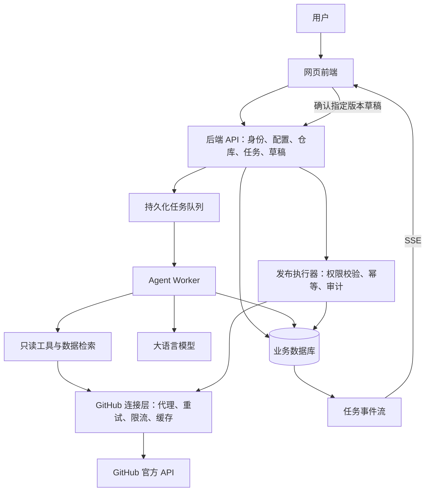
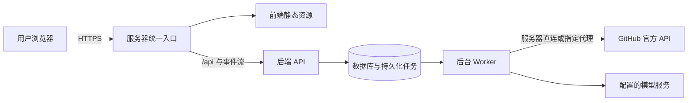

# 基于大语言模型的仓库辅助管理智能体：设计初稿

版本：v0.9 · 日期：2026-10-31 · 状态：项目工作空间架构

## 1. 项目定位

构建一个通过网页使用的仓库辅助管理系统。用户在前端导入仓库为项目、完成初始化后，在项目内下达自然语言指令，后端智能体读取仓库相关信息，完成分析、整理和跟进，并在授权范围内创建 Issue、发布 Comment。

核心价值是帮助维护者理解“仓库发生了什么、有哪些问题需要跟进、下一步应该协调什么”，减少信息整理和沟通成本。代码可作为分析证据，但系统不承担代码开发、重构、修复或性能优化任务。

### 已确定的要求

- 网页前后端分离，Agent 在后端运行。
- 用户通过前端向 Agent 下达指令。
- 核心职责是辅助仓库管理，不修改或优化仓库代码。
- 允许创建 Issue、留下 Comment。
- Agent 的 API Key、模型名称、目标仓库链接等运行配置通过网页设置，无需手动修改配置文件。
- 仓库平台仅面向 GitHub，当前仅支持公开（public）仓库，不接入私有仓库。首版范围按 github.com 设计，不包含 GitHub Enterprise Server。
- GitHub 网络连接属于核心体验：网页可配置访问方式，后端统一处理代理、连接诊断、短暂故障恢复和限流等待。
- 部署到位于中国大陆的远程服务器，用户通过网页访问；Agent、模型调用和 GitHub 访问均在服务器侧执行。
- 目标服务器公网 IP 为 `101.132.153.33`，由用户提供；现已使用 Nginx、systemd 和私有代理部署。
- 导入仓库即自动初始化，持久化关键资料、Issue、PR 与 AI 概览；后续操作归属于项目。

### 本稿采用的默认假设

- 首版服务单个维护者，每次任务只作用于一个明确选定的仓库。
- 首版 Comment 指 Issue 下的普通评论；PR 先只读分析，PR 评论作为后续扩展。
- 分析任务可直接执行；对外发布默认先形成草稿，再由用户确认。未来可以配置明确范围内的自动发布。
- 首版以用户主动触发为主，定时巡检和事件驱动属于后续阶段。

以上假设用于让初稿具体可讨论，不代表已经获得产品决策确认。

## 2. 最终实现效果

用户首次打开网页，先配置全局模型、可选 GitHub 令牌和服务器网络，再在工作台导入公开仓库。仓库是长期项目，任务是项目中的一次操作。

1. 导入 URL 后校验公开状态，创建项目并排队初始化；同一仓库重复导入打开原项目。
2. 后台确定性读取元信息、根目录、README、关键配置与 Issue/PR，保存带采集时间和覆盖限制的快照。
3. AI 根据有界资料摘录生成项目概览，不生成发布草稿。初始化失败可重试，刷新失败不覆盖上次成功资料。
4. 用户在项目中输入指令；任务固定该仓库，使用已存摘要、资料摘录和最近六条完成或待确认的任务报告，并可读取最新 GitHub 内容。
5. 前端按项目展示概览、关键文件、Issue、PR、指令历史和结果。历史资料明确标注时间，不能冒充实时事实。
6. Issue/Comment 操作先生成草稿，用户编辑、确认或放弃；确认后发布并保留真实链接。

SQLite 中 projects 记录保存状态和加密资料；tasks 通过 project_id 关联项目。初始化任务与普通分析任务由同一持久化 Worker 执行。全局凭证和网络设置独立于项目，后续修改默认仓库不会改变项目任务目标。旧任务按仓库迁移为待初始化项目，不触发网络或模型调用。

系统不能只输出一段聊天回复：用户需要知道信息来自哪里、Agent 做到了哪一步、是否产生了外部操作、哪些操作失败或尚未执行。

## 3. 功能范围与权限边界

| 能力 | 首版行为 | 边界 |
| --- | --- | --- |
| 仓库问答 | 基于 README、目录、指定文件及协作记录回答问题 | 不确定时说明缺失信息，不凭空补全 |
| 仓库简报 | 汇总指定时间范围内 Issue、PR 和提交记录 | 说明统计范围、数据时间与分页覆盖情况 |
| Issue 整理 | 总结诉求、识别缺失信息、推荐优先级和相似 Issue | 优先级与重复关系只是建议 |
| 待办跟进 | 列出长期无更新、等待回复或待维护者决策的事项 | 使用可配置规则，不把“长期未更新”等同于问题 |
| 创建 Issue | 生成有背景、证据和建议下一步的草稿并发布 | 发布前查重；不自动承诺实现或截止日期 |
| 发布 Comment | 针对明确的 Issue 起草补充说明、提问或跟进评论 | 不伪装为他人，不虚构已完成的工作 |
| PR 状态整理 | 汇总 PR 状态、已有检查结果和讨论阻塞项 | 不执行代码审查修复、不触发检查或合并 |
| 操作历史 | 查看任务、草稿、发布记录、失败原因和外部链接 | 不把未经确认的草稿标记为已发布 |

首版明确禁止：修改文件、创建分支、提交或推送代码、创建或合并 PR、触发 CI、修改仓库设置、删除内容、自动关闭 Issue、修改标签或负责人。标签、指派、关闭等管理动作可以提出建议，但实际写入需作为后续独立能力设计。

“不修改仓库”的具体含义是“不修改代码及仓库配置”；创建 Issue 和 Comment 会改变协作记录，是本项目明确允许的写操作。

公开仓库限制由后端执行：添加目标时验证公开状态，任务开始、恢复和发布前重新检查；仓库转为私有或无法确认公开状态时停止继续访问，不因已配置平台凭证而读取私有内容。公开可读与允许发布是两种独立能力；未配置发布授权时，仍可分析和生成草稿。

## 4. 方案比较与推荐

| 方案 | 主要方式 | 优势 | 局限 |
| --- | --- | --- | --- |
| 固定工作流 | 用户选择预设操作，模型负责摘要和文案 | 可控、容易验证 | 对复杂自然语言任务适应性有限 |
| 有边界的工具调用 Agent（推荐） | 模型理解指令、选择只读工具，写操作进入受控发布流程 | 保留对话灵活性，操作范围清晰 | 需要任务状态、工具策略和操作审计 |
| 开放式自主 Agent | 模型自行探索并执行多类管理操作 | 自主程度高 | 难以限制误操作与成本，超出首版需求 |

推荐第二种方案：让模型决定“查什么、如何整理、建议什么”，由确定性后端代码决定“能否执行、执行到哪里、是否已获授权”。首版不需要多 Agent 协作、任意终端或自动编程环境。

## 5. 总体架构

### 模块职责

- **前端**：网页配置、指令输入、仓库选择、报告展示、证据浏览、草稿编辑与确认、任务历史。密钥仅在用户输入和提交时短暂存在于表单中，提交后清空；不写入浏览器持久存储，也不由浏览器直接调用模型或平台服务。
- **后端 API**：认证、配置保存与连接测试、仓库公开状态和访问校验、创建任务、管理草稿版本、提供查询与事件流。前端传入的仓库和操作目标都必须重新校验。
- **Agent Worker**：在后台处理长任务，组织模型上下文、调用受限读取工具、生成报告和草稿。进程退出后任务状态仍可恢复。
- **GitHub 服务层**：封装 GitHub 的仓库、Issue、PR、评论与提交接口，不构建多平台抽象。底层统一使用 GitHub 连接层，读取工具、发布执行器和连接诊断使用相同的网络配置。
- **发布执行器**：只接受已授权的具体动作，验证目标与草稿版本，执行创建 Issue 或发布 Comment，记录结果。
- **数据库与任务队列**：保存业务状态、事件、证据引用和操作日志；队列负责派发，数据库是任务状态的依据。

建议技术候选为 TypeScript 前端、Python 后端、关系数据库和独立 Worker。具体框架、队列与模型提供商在确认团队经验、部署条件后再定；本稿不依赖特定框架版本或 Agent 框架。

### 远程服务器部署

首版按单台中国大陆远程服务器设计，前端静态资源、后端 API、Agent Worker、数据库和任务队列作为职责独立的服务运行。可使用容器编排或进程管理器部署，具体工具尚未确定；无需首版就拆成多台服务器。

当前部署信息：

| 项目 | 已知信息与设计约定 |
| --- | --- |
| 服务器公网 IP | `101.132.153.33` |
| 部署地区 | 中国大陆 |
| 网页入口 | 计划通过指向该 IP 的域名提供 HTTPS；域名与证书尚未配置，不代表服务已经上线 |
| 服务器环境 | 操作系统、运行时、现有服务和部署权限尚未核实 |
| GitHub 出网 | 需要在该服务器的 Worker 环境测试直连或指定代理 |
| 代理出口 | 用户已提供含访问 token 的 HTTPS 订阅链接；尚未下载、解析或测试，实际节点协议与可用性未确认。完整链接按秘密保存，不写入设计文档 |

部署地址保留为环境配置，不硬编码进前端 API 地址或业务逻辑。浏览器通过同源 `/api` 访问后端，后续绑定域名或更换服务器时不需要修改业务代码。当前不把该 IP 直接设为网页代理地址或模型服务地址。

- **网页入口**：前后端独立开发和部署，通过同一域名提供网页与 `/api`，减少跨域配置。公网访问使用 HTTPS；发布入口、设置和任务均要求登录，首版按单管理员账户设计，不提供公开注册。
- **内部服务**：数据库、队列和 Worker 不直接暴露到公网；统一入口转发 SSE 时支持流式响应和心跳，避免进度被代理缓冲。
- **后台运行**：关掉浏览器后任务继续执行，重新登录可以查看进度。服务重启按持久化记录恢复任务；发布结果不明时先核实远端状态。
- **凭证与数据**：配置、任务、草稿、报告和审计记录持久化保存。加密主密钥与数据库备份分开保管，制定备份与恢复流程，避免重启或重新部署丢失配置。
- **部署配置与网页配置分工**：域名、TLS、数据库连接、加密主密钥、初始管理员和允许的代理端点由部署环境提供；日常模型配置、GitHub 凭证、目标仓库和已允许代理的选择通过网页管理。
- **服务状态**：分别展示应用、Worker、GitHub 连接和模型连接的状态。GitHub 不可达不应导致设置页不可用，用户仍能登录、修复连接配置和查看历史报告。

服务器位于中国大陆，供应商和现有出网能力尚未确定。部署前从服务器实际网络环境分别验证 GitHub 和所选模型服务，不能用用户电脑上的连通性代替验收，也不能仅凭地区推断实际可用性。

### 中国大陆部署的网络落地方案

- **先诊断再启用任务**：首次配置时分别测试 GitHub API、目标公开仓库和模型接口，展示成功率、延迟及错误类型。模型尚不可用时仍可保存设置和验证仓库；GitHub 不可用时允许查看历史结果和修改网络配置，相关新任务提示先修复连接。
- **直连与代理均作为正式能力**：直连通过实测后可使用；直连不稳定时，由管理员配置服务器可达的 HTTP CONNECT 或 SOCKS5 代理并测试。配置指定代理后，任务读取、发布和诊断统一走该路径，不每次先尝试直连再等待超时。
- **代理作为部署依赖**：用户已提供代理订阅，部署方案包含服务器侧代理客户端，负责将订阅中的可用节点转换为应用可用的 HTTP CONNECT 或 SOCKS5 入口。应用不负责购买或搭建远端代理节点。订阅、客户端或节点不可用且直连失败时，明确显示需要修复的环节，不把增加重试次数当作解决方案。
- **模型服务独立检查**：用户填写的服务地址、API Key 和模型名称必须从 Worker 环境实际验证；GitHub 连接成功不代表模型接口可达。两者保留独立连接状态和网络策略。
- **网页减少外部依赖**：前端脚本、样式、图标和字体随应用部署，不把 GitHub 或境外公共 CDN 资源作为页面正常加载的必要条件。仓库 README 中的外部图片默认不作为报告的必要内容自动加载，保留原始链接。
- **上线前验收**：在目标服务器执行连续读取、分页读取、代理中断恢复及模型调用测试；在专用 GitHub 测试仓库确认 Issue 和评论发布流程。记录采样时段、成功率和延迟，不能只凭单次连接成功判定“访问流畅”。具体性能门槛依据首轮实测和任务规模确定。

上述内容是部署设计与验收要求，目前未接入实际服务器，也未验证其网络质量。

### 代理订阅接入

订阅 URL 是获取节点配置的地址，不是可直接填入 HTTP 或 SOCKS5 客户端的代理端点。拟定连接链路为：`Agent Worker → 服务器侧代理客户端 → 订阅中选定的节点 → GitHub 官方 API`。订阅下载是独立的配置更新流程，不参与每次 GitHub 请求。

- **网页管理**：管理员可提交或替换订阅链接、手动更新订阅、查看脱敏后的节点名称与状态、选择节点并测试 GitHub 连接。导入后只显示“订阅已配置”、更新时间和错误状态，不回显完整链接或查询参数。
- **客户端选型**：先受控下载并识别订阅格式，再选择能处理其实际节点协议的客户端；目前不预先认定该订阅为某种格式，也不宣称节点已可用。首版默认手动更新，不在每次任务启动时重新下载。
- **订阅获取**：由受限后端组件通过 HTTPS 下载，验证证书，限制响应大小、超时与重定向；目标和重定向地址执行网络访问校验。首次下载优先使用服务器直连；若不可达，需要另一个已可用的出口完成引导，不能依赖尚未导入的订阅建立自身连接。证书错误明确报错，不自动关闭验证。
- **配置处理**：将订阅视为不可信输入，只提取受支持的节点字段，限制节点数量并校验目标地址；不直接执行订阅附带的脚本，也不接受其任意覆盖监听地址、控制接口、文件路径或系统配置。
- **安全保存**：完整订阅 URL、节点密码和代理密钥加密存储，不进入模型上下文、前端持久存储或日志。诊断错误和审计记录去除 URL 查询参数，配置导出排除这些秘密。
- **运行隔离**：代理客户端仅向 Worker 可达的受限内部网络提供服务，控制接口不暴露公网；网页经后端管理客户端。具体监听地址由部署环境确定，不把用户提供的订阅地址作为客户端监听地址。
- **更新与恢复**：新订阅先解析、校验并测试选定节点，成功后在请求边界切换；更新失败保留上一份有效配置，不覆盖为不可用状态。节点切换与 GitHub 网络配置变更记录审计，可能已经送出的发布操作先核实结果，避免重复发帖。

当前完整订阅链接仅存在于用户提供的对话内容中，尚未保存到服务器或任何配置存储。正式部署时通过设置页或秘密注入方式配置，不提交到代码仓库。

## 6. Agent 工作机制

### 一次分析任务

1. 解析意图，明确仓库、时间范围、所需数据和期望输出。
2. 缺少操作目标等关键信息时请求补充；可合理默认的信息明确展示默认值。
3. 通过只读工具收集 Issue、评论、PR、提交及必要文档。
4. 保留证据链接、来源更新时间和采集时间，按相关性压缩上下文。
5. 输出结论、证据、限制与建议动作；需要发布时生成结构化草稿。
6. 检查结论是否有证据、目标是否明确、是否超出职责范围。
7. 保存结果并结束分析；有草稿时进入等待确认状态。

首版工具可包括 `get_repository`、`list_issues`、`get_issue`、`list_comments`、`list_pull_requests`、`list_commits`、`read_file` 和 `search_issues`。写入接口只包含 `create_issue` 与 `create_issue_comment`，由发布执行器调用，不直接暴露给模型自由执行。

工具清单是内部接口设计，不代表已经完成 GitHub 接口联调。实现时需逐项核对 GitHub API、权限要求与返回结构。

### 上下文与信息质量

- 首版采用按需读取和查询，避免每次把整个仓库送入模型。
- 读取代码仅用于理解背景与定位证据，不执行仓库脚本或安装仓库依赖。
- 长讨论可分段摘要，但保留原始链接和关键论点，不能把摘要当作新的事实来源。
- 报告显示数据覆盖范围；分页、时间窗口或权限导致数据不完整时明确提示。
- 将事实、模型推断、建议分开呈现；无法确认的事项以问题形式表达。
- 暂不要求向量数据库；只有实际检索需求证明必要时再引入。

### 执行边界

每个任务配置最大执行时长、工具调用次数、输入输出规模和模型预算。达到限制时返回已完成部分及限制原因，不无限循环。仓库文本是待分析数据，不能覆盖系统权限或指示 Agent 访问其他仓库、泄露令牌或执行额外操作。

## 7. 发布与授权流程

默认交互是“生成草稿 → 用户检查或编辑 → 确认具体版本 → 后端发布”。确认对象包含操作类型、仓库、Issue 目标（若适用）、正文及版本，不能用一次笼统确认授权后续所有发布。

- 编辑草稿会产生新版本；旧版本的确认不能发布新正文。
- 发布时重新校验用户权限、目标是否存在及状态是否变化；明显过期或目标变化的草稿需要重新检查。
- 创建 Issue 前检索相似记录并提示，不能仅凭标题自动判定重复。
- 由系统生成操作标识，阻止双击与重复消费造成同一次操作多次提交。
- 外部 API 超时不等于失败。结果无法确认时标记为“结果待核实”，查询远端后再决定是否重试，不盲目重复发帖。
- 发布后正文作为已执行版本留档；首版不自动编辑或删除已经发布的内容。
- 凭证仅保存在后端，通过部署密钥保护，日志与模型上下文均不包含凭证；只配置业务必需权限。若平台权限粒度过粗，仍由服务端白名单限制实际动作。

后续若支持自动发布，应按仓库、动作类型、触发条件和频率配置规则，并保留暂停入口；这不是首版默认行为。

## 8. 前端页面

### 仓库工作台

展示当前仓库、数据更新时间、最近任务、待确认草稿和常用任务入口。仓库状态指标必须有明确定义，首版不生成缺乏解释的“健康分”。

### 对话与任务详情

提供指令输入区、任务状态、结构化报告和证据引用。过程展示工具名称、进度和结果概述，不要求公开模型内部推理。断线重连后可恢复已保存的任务事件，并查询最终状态。

### 草稿与发布面板

清晰展示发布仓库、目标 Issue、标题、正文预览、关联证据和重复提示。用户可编辑、确认或放弃；成功显示外部链接，失败显示可采取的下一步。

### 历史

历史页按仓库和时间查看任务及操作。取消任务只停止后续执行，不撤回已经成功发布的内容。

### 网页设置

首版提供一个默认模型配置和当前目标仓库配置。配置保存在后端，刷新网页或重启服务后仍然有效。

| 配置分组 | 字段 | 行为 |
| --- | --- | --- |
| 模型服务 | 提供商或接口类型、API Base URL、API Key、模型名称 | 提供商可预填地址，支持受支持协议的自定义地址；模型名称支持手动输入 |
| 目标仓库 | GitHub 公开仓库 URL | 接受 `https://github.com/{owner}/{repo}`，规范化后由官方 API 验证稳定仓库标识与公开状态；拒绝其他平台 |
| GitHub 授权 | GitHub 访问凭证或授权连接 | 与模型 API Key 分开管理；显示发布身份和可用能力，未授权时仅分析和生成草稿 |
| GitHub 网络 | 自动、直连、指定代理；代理协议、地址、端口与可选认证 | 支持 HTTP CONNECT 和 SOCKS5 代理，可使用服务器代理客户端提供的入口，提供测试连接、当前有效路径与故障提示；不与模型服务配置混用 |
| 代理订阅 | 订阅 URL、手动更新、节点选择 | 由服务器客户端解析并提供代理入口；链接和节点凭证按秘密管理，更新失败保留有效配置 |
| 运行参数 | 超时时间、工具调用上限、输出长度或预算 | 提供默认值与允许范围，避免首次使用必须配置所有参数 |

设置页提供“测试模型连接”“验证仓库”“保存”以及密钥的“替换”“删除”操作。连接测试由后端完成；模型测试使用最小请求，提示可能产生少量调用费用，不向测试请求附带仓库内容。只有保存后的有效配置可用于新任务，测试成功不自动保存。

API Key 保存后只返回已配置状态和掩码，不返回完整值。普通配置查询和导出不包含秘密；后端加密保存密钥，加密主密钥由部署环境提供，不放在网页可导出的配置中。设置接口须受应用身份认证保护，即使分析目标全部公开也不能允许匿名用户读取设置或消耗模型额度。

自定义模型地址由后端验证协议和目标地址，默认使用 HTTPS，拒绝指向内网、回环和云元数据地址的请求及重定向；首版不支持通过网页连接本地模型服务。更换服务地址时需要重新提供或明确绑定对应密钥，不能把旧提供商的密钥自动发送到新地址。

配置变更对新任务生效。任务保存非秘密配置快照和凭证版本引用，运行中不随网页切换模型或仓库；旧草稿继续绑定原仓库，发布面板明确显示原目标。删除或撤销凭证后，使用该凭证的任务停止后续外部调用；已发出的调用仍需核实结果。

## 9. 核心数据与接口

### 数据对象

| 对象 | 关键内容 |
| --- | --- |
| ModelConfiguration | 配置版本、接口类型、Base URL、模型名称、密钥引用、运行参数、测试结果与时间 |
| GitHubNetworkConfiguration | 配置版本、连接模式、代理端点、代理认证引用、超时与重试参数、测试结果与时间 |
| ProxySubscription | 加密订阅链接引用、客户端类型、配置版本、更新时间、脱敏节点列表、选定节点及测试状态；节点凭证不在普通查询中返回 |
| Credential | 所属用户、用途、加密值、版本、掩码、撤销状态；不随普通配置查询返回 |
| RepositoryConnection | 平台、仓库 URL 与稳定标识、公开状态及检查时间、授权主体、可选凭证引用、能力范围 |
| Conversation | 所属用户、仓库、消息与关联任务 |
| Task | 用户指令、仓库、模型配置快照与凭证版本引用、状态、执行范围、预算、结果、错误 |
| TaskEvent | 任务标识、递增序号、事件类型、时间、可展示摘要 |
| Evidence | 来源链接、资源标识、采集时间、来源更新时间、引用片段 |
| ActionDraft | 操作类型、目标、正文、版本、依据、当前状态 |
| Approval | 确认用户、草稿版本、内容摘要值、确认时间 |
| ActionExecution | 操作标识、执行状态、外部资源标识与链接、错误或待核实原因 |
| AuditRecord | 操作者、目标、动作、时间与结果；不保存密钥 |

所有查询与操作按用户和仓库隔离。证据缓存与对话的保留期限需要在实际部署前确定；删除连接时停止新任务并清理凭证，历史记录按保留策略处理。

### 建议接口

| 接口 | 用途 |
| --- | --- |
| `GET /api/settings` | 获取非秘密配置、凭证掩码及连接状态 |
| `PUT /api/settings/model` | 保存模型配置，密钥替换与保留使用明确字段语义 |
| `POST /api/settings/model/test` | 测试指定模型配置，不自动保存 |
| `PUT /api/settings/platform-auth` | 保存或更新平台授权 |
| `PUT /api/settings/github-network` | 保存 GitHub 网络配置，代理认证不在查询结果中回传 |
| `PUT /api/settings/proxy-subscription` | 管理员保存或替换加密订阅链接，不回传秘密 |
| `POST /api/settings/proxy-subscription/refresh` | 异步下载、校验与测试候选配置，返回任务 ID |
| `GET /api/settings/proxy-subscription` | 获取脱敏状态、更新任务进度、可选节点与当前有效版本 |
| `PUT /api/settings/proxy-subscription/node` | 测试并选择节点，成功后按请求边界切换 |
| `POST /api/settings/github-network/test` | 在 Worker 所在网络环境异步诊断指定配置，返回诊断 ID |
| `GET /api/settings/github-network/tests/{id}` | 获取诊断步骤、脱敏错误、有效路径及延迟 |
| `DELETE /api/credentials/{id}` | 撤销并删除指定凭证的秘密值 |
| `POST /api/repositories/validate` | 验证仓库链接与公开状态，返回规范仓库信息 |
| `PUT /api/settings/target-repository` | 保存当前目标仓库，后端再次校验公开状态 |
| `GET /api/repositories` | 获取当前用户已配置的公开仓库及能力状态 |
| `POST /api/tasks` | 创建任务，返回任务 ID；支持客户端请求标识避免重复创建 |
| `GET /api/tasks/{id}` | 获取状态、报告、证据及草稿 |
| `GET /api/tasks/{id}/events` | SSE 订阅进度，支持按事件序号恢复 |
| `POST /api/tasks/{id}/cancel` | 请求停止尚未执行的步骤 |
| `PATCH /api/drafts/{id}` | 编辑草稿，校验版本并生成新版本 |
| `POST /api/drafts/{id}/confirm` | 确认指定版本并提交发布任务 |
| `POST /api/drafts/{id}/discard` | 放弃尚未发布的草稿 |
| `GET /api/actions/{id}` | 查询发布结果，包括待核实状态 |

任务状态：`queued → running → waiting_confirmation → completed`；无草稿时可直接完成。网络故障进入 `waiting_network`，限流进入 `waiting_rate_limit`，恢复条件满足后返回 `queued`；达到任务截止时间则进入 `failed`，用户取消进入 `cancelled`。多草稿任务可独立确认，各草稿均已发布或放弃后任务结束。发布执行单独记录 `pending / executing / succeeded / failed / unknown`，避免分析成功掩盖发布失败。

## 10. 异常处理与可运维性

| 情况 | 预期行为 |
| --- | --- |
| 模型服务失败 | 有限重试；保存进度并说明失败，不能生成虚假的成功结果 |
| 平台限流 | 按平台响应延后读取或执行，向前端显示等待状态 |
| 授权失效或不足 | 停止相关操作，提示重新连接或调整授权 |
| 模型配置无效 | 区分地址不可达、密钥无效、模型不可用及接口不兼容，返回脱敏错误 |
| 目标仓库非公开或无法确认公开状态 | 拒绝接入或暂停已有任务，不使用凭证绕过公开仓库限制 |
| Issue 已关闭或讨论已有新进展 | 提示目标变化，重新检查草稿的必要性 |
| Worker 重启 | 从持久化状态恢复；执行中的写操作先核实远端结果 |
| 数据不足 | 返回有依据的部分结论，并说明无法判断的内容 |
| 用户取消与发布并发 | 尚未发出的操作停止；已发出操作继续核实并如实记录结果 |
| 仓库内容包含恶意指令 | 仅作为数据处理；工具权限、目标和发布授权仍由后端控制 |

记录任务耗时、模型用量、工具调用次数、失败率及发布结果。日志应能串联任务、草稿和执行记录，敏感信息应脱敏。当前仅接入公开仓库；设置页说明所选模型服务会接收任务指令和必要的仓库内容，密钥不进入模型上下文。

### GitHub 网络访问专项设计

**目标与部署条件。** 用户只需访问本系统网页，GitHub 数据读取与发布均由后端完成，不要求用户浏览器能够直接连接 GitHub。后端应部署在能稳定访问 GitHub 的环境，或连接用户配置的可用代理；无可用出口时系统给出具体诊断与恢复入口，不承诺仅靠重试消除网络阻断。外部证据链接仍指向 GitHub，同时在系统内保留已采集的必要摘要，避免查看报告必须打开外站。

**连接模式。** 默认“自动”：已有显式配置或部署环境代理时优先使用代理，否则直连；没有配置代理时不自动寻找第三方代理。自动模式下，只读请求发生可重试的网络故障时可在已配置路径间有限切换；“指定代理”模式禁止静默改为直连。所有模式保留 TLS 证书验证，不通过关闭证书校验解决连接失败。SOCKS5 支持由代理端解析 GitHub 域名，以处理本地 DNS 失败；直连与 HTTP 代理的诊断按实际解析路径报告。

项目已确定远程部署，代理必须是服务器可访问的出口，不能直接填写用户电脑上的回环代理。若代理进程与 Worker 同机且共享网络命名空间，可使用服务器回环地址；容器中的 `127.0.0.1` 指向容器自身，需改用可达的代理服务地址。网页明确标注“服务器侧代理”，显示当前连接模式与最近诊断时间。代理配置仅允许管理员修改，本地或内网代理端点须在部署侧允许范围内，代理认证加密保存；代理服务不作为公网开放代理。这里的代理端点例外不放宽自定义模型目标地址的限制。模型调用是否使用代理单独配置，不隐式继承 GitHub 代理。

**统一官方入口。** 主要通过 `api.github.com` 的 REST API 获取数据，包括按需读取文件，不依赖网页抓取、完整克隆或第三方 GitHub 镜像。确需访问官方原始文件等其他域名时，使用明确的域名白名单与相同网络策略，跨域不转发 GitHub 授权头。仓库链接不能成为任意 URL 抓取入口。

**诊断流程。** “测试 GitHub 连接”在实际执行任务的 Worker 网络环境中运行，依次检查配置、直连或代理连通性、TLS、官方 API、目标仓库公开状态和凭证状态，报告每步耗时。使用只读请求，不发测试 Issue 或 Comment；无法仅靠只读检查确认发布能力时标记“尚未验证”，不把可读误报为可写。区分 DNS 失败、代理不可达或认证失败、TLS 错误、连接或读取超时、GitHub 服务错误、限流和权限问题，给出对应设置入口。

**超时与恢复。** 初始建议连接超时 5 秒、单次请求总时限 30 秒，可在受限范围内调整；这些是本产品初始参数，不是 GitHub 服务保证。只读请求遇到临时网络故障或可重试服务错误时，最多自动重试 2 次，采用指数退避和随机抖动；认证失败、普通权限错误、无效请求和不存在的资源不盲目重试。任务预算涵盖重试，连续失败后暂时停止探测并展示“连接异常”，避免页面无限加载。

**限流与请求控制。** 统一按凭证或匿名出口协调请求，默认串行调用并合并重复读取；发布进入独立受控队列。限流时优先遵守 `Retry-After`；主限额耗尽时等待 `X-RateLimit-Reset`；无明确等待头的次级限流至少等待一分钟，再逐步增加间隔并限制次数。等待不占用 Worker 阻塞线程，通过持久化调度恢复，网页显示原因、下次尝试时间并允许取消。不能通过换代理、换 IP 或凭证轮换绕过限流。上述策略依据 [GitHub REST API 最佳实践](https://docs.github.com/en/rest/using-the-rest-api/best-practices-for-using-the-rest-api) 与 [故障排查文档](https://docs.github.com/en/rest/using-the-rest-api/troubleshooting-the-rest-api)。

**缓存与前端体验。** 利用 ETag 或 Last-Modified 做条件请求，缓存仓库元数据及已读取页面，恢复任务时复用检查点，减少重复传输。断网时允许查看已有报告，明确显示采集时间与“非最新数据”；公开状态无法重新确认时不继续外部读取或发布。前端显示“正在连接 / 正在重试 / 等待限流恢复 / 连接异常”，通过 SSE 推送，SSE 失败时以有间隔的状态查询降级。恢复连接后继续未完成读取，不重复生成已成功发布的内容。

**写操作与配置切换。** 创建 Issue 或 Comment 一旦请求可能已经送出，超时或切换网络路径都必须先核实结果，不能套用只读自动重试逻辑。用户修复网络设置后，暂停任务可在请求边界采用新的连接配置版本，并记录切换事件；这仅改变网络路径，不改变任务的仓库、模型或已确认正文。正在执行的请求不被无痕迁移。

## 11. MVP 与后续演进

### 第一阶段：可用的只读助手

仅接入 GitHub 公开仓库；提供模型 API Key、模型名称、服务地址、仓库链接与 GitHub 网络的网页配置、连接测试和持久化保存。直连与代理访问、诊断、有限重试和限流等待纳入本阶段。支持仓库选择与自然语言任务，完成仓库简报、Issue 总结和证据展示，具备后台任务与历史记录。

### 第二阶段：可控的协作闭环——MVP 完成标准

实现 Issue 与 Comment 草稿、编辑确认、真实发布、幂等处理与审计。此时产品应完整演示“指令 → 分析 → 草稿 → 发布 → 追踪”。

### 第三阶段：持续辅助管理

在前两阶段稳定后考虑定时简报、Webhook 触发、PR 普通评论、多仓库视图和明确规则下的自动评论。标签、指派和关闭操作若要加入，单独评估其权限和误操作恢复方式。

首版不纳入代码修复、自动合并、多 Agent 调度、复杂知识图谱和跨平台统一管理，避免分散仓库辅助管理这一核心目标。

## 12. 验收与评估

以下是拟定验收目标，尚未进行实际测试。

| 场景 | 通过标准 |
| --- | --- |
| 网页配置 | 不修改配置文件即可保存模型和公开仓库配置，刷新或重启后仍可使用 |
| 远程部署 | 使用 HTTPS 登录网页完成配置与任务；数据库和队列不暴露公网，未登录无法调用任务与配置接口 |
| 后台持续运行 | 关闭网页后任务继续，重新打开可恢复查看；服务重启后配置与任务记录仍在 |
| 服务器出网 | 从实际 Worker 环境验证 GitHub 和模型服务；用户电脑代理关闭不影响已配置的服务器出口 |
| 中国大陆部署验收 | 在目标服务器记录多次请求与分页读取的成功率、延迟及恢复结果；选择指定代理后不先等待直连失败 |
| 网页资源独立 | GitHub 或外部 CDN 不可达时，登录、设置、任务状态与历史报告页面仍能加载 |
| 出网故障隔离 | GitHub 不可达时设置页和历史报告仍可用，可修改服务器侧代理并重新诊断 |
| GitHub 平台范围 | 仅接受 github.com 公开仓库，拒绝其他平台和私有仓库 |
| 直连与代理 | 分别验证直连、HTTP CONNECT、SOCKS5；前端无法直连 GitHub 但后端可达时，核心流程仍正常 |
| 网络诊断 | 注入 DNS、代理认证、TLS 和超时故障，页面显示对应原因及恢复入口；首次诊断进度在 2 秒内反馈，单次探测按配置时限结束 |
| 网络恢复 | 短暂中断后有限重试并恢复；持续故障停止重试；修复代理后可继续暂停任务，无须重新生成已完成结果 |
| 限流等待 | 模拟响应头，验证到期前不重试、前端可见等待状态、重启后仍遵守等待时间 |
| 发布中断 | 模拟服务端成功但响应丢失，进入待核实状态，切换网络也不会自动重复发帖 |
| 凭证管理 | 保存后查询仅返回掩码，支持替换和删除，日志及浏览器持久存储无明文密钥 |
| 订阅导入 | 可识别受支持格式并测试节点；证书错误、格式不支持或节点不可达时返回明确原因，不宣称连接成功 |
| 订阅更新与保密 | 更新失败不破坏有效配置，链接 token 与节点凭证不出现在日志、配置导出和普通查询中 |
| 配置隔离 | 更改模型或目标仓库只影响新任务，旧任务和草稿保留原目标 |
| 公开仓库限制 | 私有或公开状态不可确认的仓库被拒绝；已接入仓库转为私有后停止后续访问 |
| 未配置平台授权 | 可读取公开资料、分析和起草，发布入口提示配置授权 |
| 仓库周报 | 用户指定时间范围后得到结构化报告；事实性结论可回溯至来源，并说明数据覆盖范围 |
| Issue 总结 | 准确区分原始诉求、讨论共识、未决问题和模型建议 |
| 创建 Issue | 可编辑草稿，经确认后只创建一次，返回真实链接 |
| 发布 Comment | 发布到正确仓库的正确 Issue，正文与确认版本一致 |
| 重复点击与超时 | 同一操作不会因重复点击重复发布；不确定结果进入核实流程 |
| 代码修改请求 | 系统解释能力边界，可转为 Issue 草稿，不调用代码写入工具 |
| 越权或恶意文本 | 无法绕过目标仓库限制、草稿确认或权限校验 |
| 中断与恢复 | 刷新页面可继续查看任务；Worker 重启不会丢失发布记录 |
| 取消执行 | 停止后续步骤，清楚列出已经执行或仍待核实的动作 |

准备一组固定测试仓库与人工标注任务，覆盖正常讨论、重复 Issue、长讨论、权限不足、缺失数据和恶意文本。使用模拟平台响应测试超时与限流，在专用测试仓库验证真实发布。报告生成质量由人工检查事实正确性、证据支持度、遗漏和建议可用性；不以“语言流畅”替代准确性。

建议记录完成任务所需时间、草稿被采纳比例和用户编辑幅度，评估是否实际减少维护者工作量。具体质量与延迟数值目标在完成首轮样本评估后确定。

## 13. 下一轮讨论重点

优先确定的问题是 **Agent 对外发布的自主程度**：

- A：所有 Issue 与 Comment 都先预览、逐条确认（本稿推荐的首版方式）。
- B：用户明确说“发布”时直接执行，其他情况先给草稿。
- C：在预设规则下自主发布，用户事后查看记录。

平台已确定为 GitHub，仓库范围已确定为 public，部署位置已确定为中国大陆远程服务器。后续确认实际出网条件、主要服务对象、最重要的三类管理任务，以及是否需要定时巡检；容器或进程管理器属于之后的部署选型。确认这些产品目标后，再细化页面原型、技术选型与实施计划。

## 14. 当前实现与验证状态（2026-10-30）

本节记录实现状态；前文仍是完整目标设计，不能将前文所有目标理解为已经完成。

### 已实现的核心闭环

- React/TypeScript 中文网页，包含登录、工作台、任务历史、报告与证据、版本化草稿审核，以及模型/GitHub/网络/订阅设置。
- FastAPI 后端与独立 Python Worker，SQLite WAL 持久化队列和业务数据；单服务器、单管理员。
- OpenAI-compatible Chat Completions 模型工具循环；模型仅能读取 GitHub 数据和提出草稿，发布由确定性执行器完成。
- GitHub 公开仓库校验、受限分页、只读重试、持久化限流等待、任务取消与恢复。
- Issue/评论确认发布，草稿版本锁定，唯一操作标记，超时后只读核实而非盲目重发。
- 凭证加密与撤销、会话与 CSRF 校验、服务器侧代理设置。
- 受支持订阅解析、Mihomo 节点测试与切换、候选失败或取消时回滚、删除订阅后的客户端清理。
- Docker Compose、Caddy HTTPS 入口、密钥初始化和数据库备份脚本。

### 与完整目标的差距

- 连接诊断目前以 API/目标仓库结果为主，未实现独立 DNS/TLS 耗时分解、长期成功率仪表盘和 ETag 缓存。
- 自动网络模式目前使用已配置代理或直连，不自动遍历多个出口；模型服务目前只提供独立直连适配。
- 模型仅支持兼容 Chat Completions 且支持工具调用的服务；订阅仅支持文档列出的 SS、Trojan 和 VMess 类型。
- 前端以定时查询展示实时进度；后端具备 SSE 接口，前端尚未切换为 SSE 优先。
- 定时巡检、Webhook、多用户和多仓库总览未纳入本次核心初版。

### 部署与真实外部验证

已进行自动化模拟接口测试、前端构建、Compose 配置校验与本地浏览器检查。未使用真实模型密钥或 GitHub 写入凭证，未下载用户提供的订阅，未连接目标服务器。Docker daemon 在当前环境不可用，因此尚未完成真实镜像构建和容器联调。

远程部署需要服务器 SSH 用户名、端口及本机可用密钥或 SSH 别名，另需网页域名和实际模型/GitHub 配置。具体操作与限制见 `README.md`，接口见 `docs/api-contract.md`，测试记录见 `docs/verification.md`。
